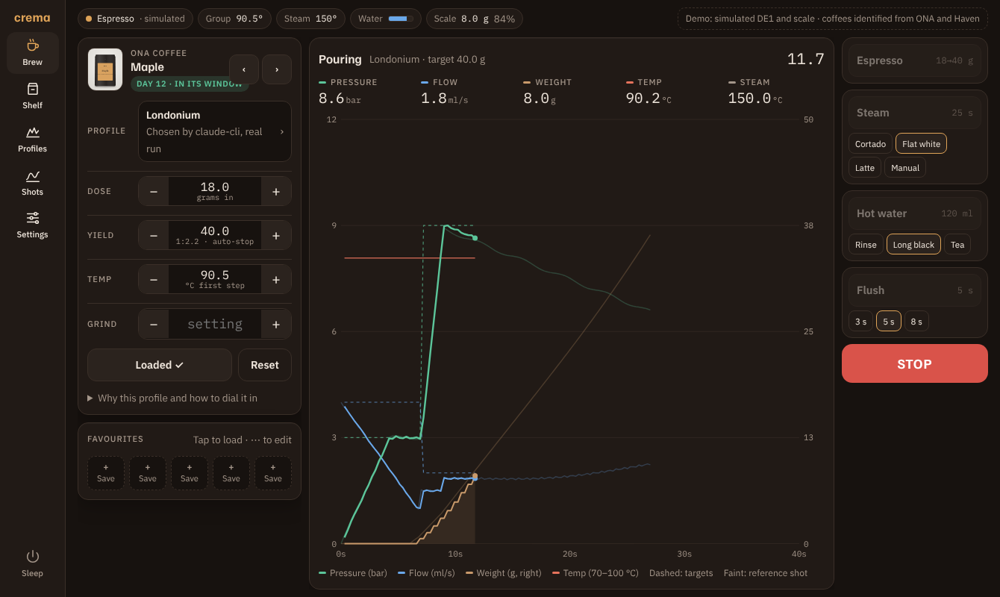

# Crema

A custom home screen and companion app for the **Decent DE1** espresso machine.

It runs on the DE1's own tablet in place of the Decent interface, and the same app runs on your iPhone. It identifies coffees from a photo of the bag, picks a community espresso profile to suit each one, and helps you dial it in shot by shot.



## What it is, in plain terms

- **The DE1** is an espresso machine with an Android tablet mounted on it. The tablet runs the machine's interface.
- **Decaid** is Decent's open-source app on that tablet. It talks to the machine and scale over Bluetooth, stores your coffees, profiles and shots, and lets anyone build their own interface as a web page (a "skin").
- **Crema** is such a skin, plus a small server at home:
  - The skin is the interface you touch: machine controls, live shot chart, coffee shelf, profiles, shot history and settings. It controls the machine through Decaid.
  - The server identifies coffees and chooses profiles using your Claude or ChatGPT subscription. It also keeps favourites, presets and maintenance reminders.
- **On your iPhone** it's the same web app, added to the home screen from Safari. There's no App Store app.

## Screenshots

All from the demo, on the DE1 tablet's 1340 × 800 screen (Samsung Galaxy Tab A11) and an iPhone. The coffees are real ONA and Haven coffees identified by Crema's AI pipeline. The machine is simulated.

| | |
|---|---|
|  **Home screen.** The next shot with its matched profile and recipe, the live chart, and the machine controls. |  **After a shot.** Metrics, a too-fast/slow check for the profile, taste feedback and the next adjustment. |
|  **Profiles.** The AI's pick for this coffee with its reasons, the rules' ranking, and 31 community profiles. |  **Add a coffee.** Every fact is tagged as from the bag, the web, or a guess to check. |
|  **Shelf.** Rest window, grams left and a reorder nudge for each bag. |  **Shots.** History with metrics, and one shot overlaid on another. |
|  **Steam.** Jug presets, a countdown and a big Stop button. |  **Settings.** Your setup, steam and water, wake schedules, display and maintenance. |

<p>
  
  
  
</p>

**On the iPhone:** the same app, laid out for the phone.

Regenerate these with `node scripts/screenshots.cjs` (needs Playwright). `node scripts/check-tablet-fit.cjs` checks that the home screen fits the tablet without scrolling: at 1340 × 800 and the scaled sizes Android may use, with and without the navigation bar, before and after a shot.

**Interactive demo and walkthrough:** [`demo/crema-demo.html`](demo/crema-demo.html) is the whole app running in the browser against a simulated machine. [`demo/walkthrough.html`](demo/walkthrough.html) is a step-by-step tour of a day with it. Both are also published as private Claude artifacts for the repo owner.

## Features

- **A full home screen for the machine.** It has Espresso, Steam, Hot water, Flush and Stop with presets, live pressure, flow, weight and temperature with profile targets, a reference-shot overlay, five favourites, the water tank, the scale, sleep and wake, and "ready in N minutes". It fits the DE1 tablet in one screen. See [docs/parity.md](docs/parity.md) for the full comparison with the Decent app.
- **Add a coffee** by photographing the bag, searching, or pasting the roaster's link. Crema reads the bag (including the roast date), finds the roaster's page and product photo, and tags every fact with where it came from.
- **Profile recommendations from the coffee's description.** It ranks 31 community profiles (Adaptive, D-Flow, A-Flow, Londonium, Extractamundo Dos, allongés, turbo shots and more, described from their authors' own notes) against what the roaster and bag say. It also takes your setup into account (milk or straight, scale, burrs, experience). The AI then picks one and explains why in plain words.
- **Dial in**: rate a shot (sour ↔ bitter, thin ↔ heavy, stars) and get the one change to make next. Shots outside the profile's time window are flagged.
- **Shelf**: rest window, grams left (from shot doses), reorder nudges, freeze and finish.
- **Shots**: history with metrics, side-by-side comparison, ratings and notes.
- **Settings**: your setup, steam, water and flush, machine, wake schedules, display and theme, and descale and backflush reminders.

Research and design decisions: [docs/investigation.md](docs/investigation.md).

## How it fits together

```
 iPhone (home-screen web app) ─┐
                               ├──► Crema server :8787 ──► AI provider chain
 DE1 tablet (Decaid skin) ─────┘        │                    claude-cli → codex-cli → gemini-api …
          │                             ▼
          └────── WebSocket ──────► Decaid :8080 (on the tablet) ──BLE──► DE1 + scale
```

- **Decaid** is the open-source app on the DE1 tablet (formerly REA / Streamline Bridge). It owns the machine connection and stores beans, profiles and shots.
- **Crema server** (`server/`, Node + TypeScript) runs on your Home Assistant box or any always-on machine. That's where the Claude or Codex CLI is logged in. It adds identification, recipes and dial-in on top of Decaid's API.
- **Web app** (`skin/index.html`): one file that works as the tablet skin, the iPhone companion, and a self-contained demo.

## Try it without a machine

```bash
npm install
```

```bash
npm run mock:decaid
```

```bash
LLM_PROVIDERS=mock npm start
```

Then open http://localhost:8787 in a browser. Pull a simulated shot with:

```bash
curl -X PUT localhost:8080/api/v1/machine/state -d '{"state":"espresso"}'
```

Opening `skin/index.html?demo` straight from disk runs a fully in-browser demo with a simulated DE1. Its coffees are nine real ONA and Haven coffees identified by the real pipeline (`samples/beans.json`), and its recommendations are real AI runs (`samples/recipes.json`). Rebuild them with:

```bash
LLM_PROVIDERS=claude-cli npx tsx scripts/seed-samples.ts
```

```bash
LLM_PROVIDERS=claude-cli npx tsx scripts/seed-recipes.ts
```

```bash
npx tsx scripts/build-demo-data.ts && node scripts/build-demo.mjs
```

## Using real AI

Pick the providers in order of preference. Crema falls through to the next if one fails or hits a usage limit:

```bash
LLM_PROVIDERS=claude-cli,codex-cli npm start
```

| Provider | Setup on the host | Billed to |
|---|---|---|
| `claude-cli` | `npm i -g @anthropic-ai/claude-code`, then `claude setup-token` and export `CLAUDE_CODE_OAUTH_TOKEN` | Claude Pro/Max |
| `codex-cli` | `npm i -g @openai/codex`, then `codex login` | ChatGPT Plus/Pro |
| `anthropic-api` | `ANTHROPIC_API_KEY` | per token |
| `gemini-api` | `GEMINI_API_KEY` (optional `GEMINI_MODEL`) | per token / free tier |

Subscription routes are for personal use. Smoke-test a provider with a search (no photo needed):

```bash
curl -F query="Square Mile Red Brick" localhost:8787/api/identify
```

## Pointing at the real DE1

```bash
DECAID_URL=http://<tablet-ip>:8080 LLM_PROVIDERS=claude-cli npm start
```

- **iPhone:** open `http://<server-ip>:8787` in Safari, then Share → Add to Home Screen.
- **Tablet skin:** package `skin/` as a Decaid skin (see Decaid's `doc/Skins.md`). It needs to know the Crema server's address; this is on the roadmap.

## API

| Method | Path | Does |
|---|---|---|
| `POST` | `/api/identify` | multipart `images[]`, `query`, `url`, `offline` → coffee record (not saved) |
| `POST` | `/api/beans` | save a confirmed record → Decaid bean + batch |
| `GET` | `/api/shelf` | beans, batches, records and rest status |
| `POST` | `/api/beans/:id/image` | `{lookup: true}` re-find the roaster's photo, `{url}` use a specific image, `{art: "product"\|"photo"}` pick which to show |
| `GET` | `/api/images/:file` | cached roaster product photos |
| `POST` | `/api/recommend` | `{beanId}` → recipe (rules + AI) |
| `POST` | `/api/apply` | `{beanId, recipe?}` → sets the workflow on the machine |
| `GET` | `/api/shots`, `/api/shots/:id` | shot history |
| `POST` | `/api/shots/:id/feedback` | taste feedback → annotation + next adjustment |
| `GET` | `/api/health`, `/api/config` | provider chain, machine state, WebSocket URL |
| `GET` | `/api/profiles/catalog` | community profile catalog, marked installed or not |
| `GET` | `/api/profiles/rank/:beanId` | rules ranking for a coffee (instant, no AI) |
| `GET/PUT` | `/api/preferences` | your setup: drink, scale, burrs, experience, basket |
| `GET/PUT` | `/api/favourites`, `/api/favourites/:slot` | five favourite slots |
| `GET/PUT` | `/api/presets` | steam, hot water and flush presets |
| `PUT` | `/api/beans/:id/best-shot`, `/api/beans/:id/state` | reference shot; freeze, thaw or finish |
| `GET/PUT/POST` | `/api/maintenance`, `/api/maintenance/:kind/done` | backflush and descale reminders |
| any | `/decaid/*` | same-origin proxy to Decaid's REST API (machine control from the phone) |

## Development

```bash
npm test
```

```bash
npm run typecheck
```

`test/flow.test.ts` runs the whole loop against the mock machine: identify → save → recommend → apply → feedback.

## Roadmap

- [ ] Test the `claude-cli` and `codex-cli` adapters against real accounts, and tune the prompts with real bag photos
- [ ] Package `skin/` as an installable Decaid skin, with the Crema server address set in-app
- [ ] Home Assistant: expose machine state, shot count and the current coffee as sensors, and add warm-up and sleep automations
- [ ] Coffee bags from roaster order emails (Gmail), so you only photograph the roast-date sticker
- [ ] Ghost overlay of your best shot of the same bag on the live chart
- [ ] Grams-left tracking from actual doses; reorder nudge
- [ ] Theme tokens matched to your Home Assistant dashboard
- [ ] Optional native iOS extras: widgets and a Live Activity for shots
