# Crema

A custom home screen and companion app for the **Decent DE1** espresso machine.

It runs on the DE1's tablet in place of the stock Decent interface, and the same app works on your phone. It identifies coffees from a photo of the bag, picks a community espresso profile to suit each one, and helps you dial it in shot by shot.

[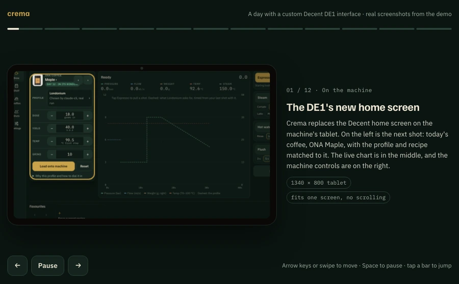](https://gauravawadhwal.github.io/crema/)

**[▶ Play the interactive walkthrough](https://gauravawadhwal.github.io/crema/)** · **[Try the full demo](https://gauravawadhwal.github.io/crema/app/)** (a simulated DE1, right in your browser) · [MP4 video](docs/media/walkthrough.mp4)

## What it is, in plain terms

- **The DE1** is an espresso machine with an Android tablet mounted on it. The tablet runs the machine's interface.
- **Decaid** is Decent's open-source app on that tablet. It talks to the machine and scale over Bluetooth, stores your coffees, profiles and shots, and lets anyone build their own interface as a web page (a "skin").
- **Crema** is such a skin, plus an optional server at home:
  - The skin is the interface you touch: machine controls, live shot chart, coffee shelf, profiles, shot history and settings. It controls the machine through Decaid and keeps its own data in Decaid too, so it works on the tablet alone. Its rules pick a profile, recipe and dial-in changes for each coffee.
  - The optional server adds AI: it identifies coffees from a bag photo, a description you type or say, or a link, and makes the profile choice and dial-in advice with an LLM (a Claude or ChatGPT subscription via their CLIs, or an API key). AI can be switched off in Settings, and if the server stops answering, the rules take over.
- **Shot review** is available after brewing and in history. Tap **Review shot** to inspect recorded curves with optional taste feedback. Local checks work without the server; AI adds interpretation when enabled. The review is saved with the shot and suggests at most one change, without applying machine settings.
- **On a phone** it's the same web app, added to the home screen from the browser. There's no app store app.

**To install it, see [docs/install.md](docs/install.md).**

## Screenshots

All from the demo: a 1340 × 800 landscape tablet (the DE1 tablet size) and an iPhone. The sample coffees are publicly listed ONA and Haven coffees identified by Crema's AI pipeline. The machine is simulated.

| | |
|---|---|
| 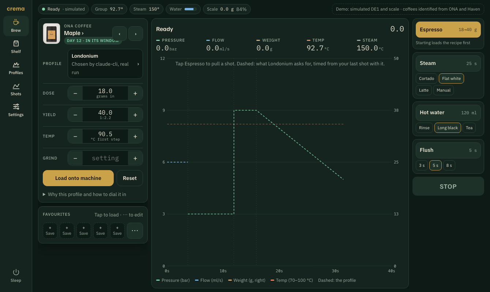 **Home screen.** The next shot with its matched profile and recipe, the live chart, and the machine controls. | 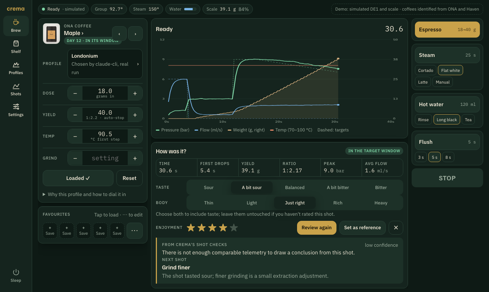 **After a shot.** Metrics, a too-fast/slow check for the profile, optional taste feedback and a saved shot review. |
| 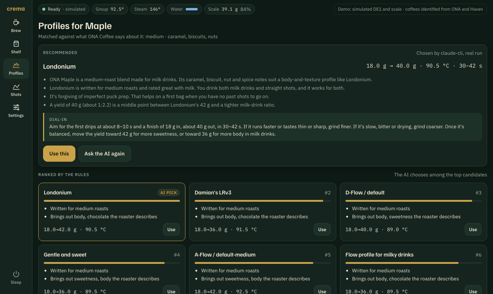 **Profiles.** The AI's pick for this coffee with its reasons, the rules' ranking, and 31 community profiles. | 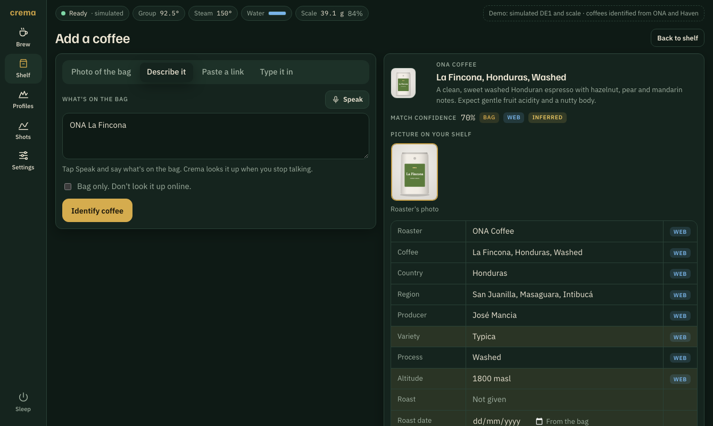 **Add a coffee.** Every fact is tagged as from the bag, the web, or a guess to check. |
| 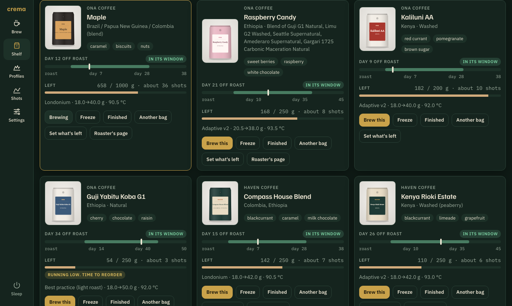 **Shelf.** Rest window, grams left and a reorder nudge for each bag. | 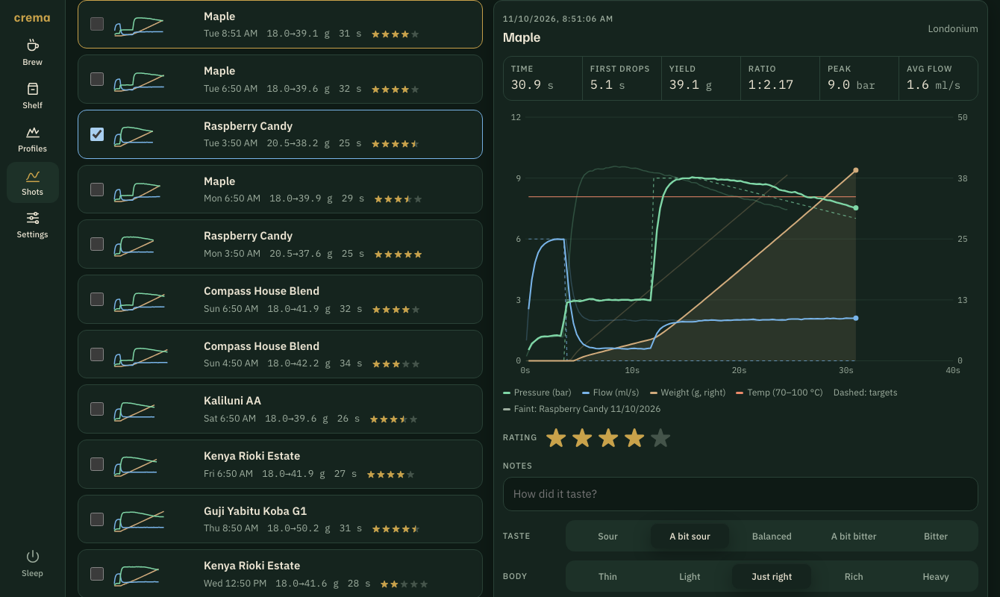 **Shots.** History with metrics, and one shot overlaid on another. |
| 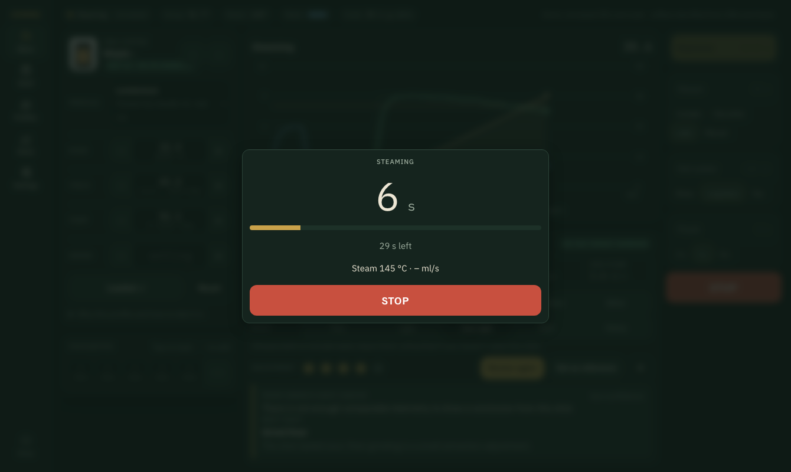 **Steam.** Jug presets, a countdown and a big Stop button. | 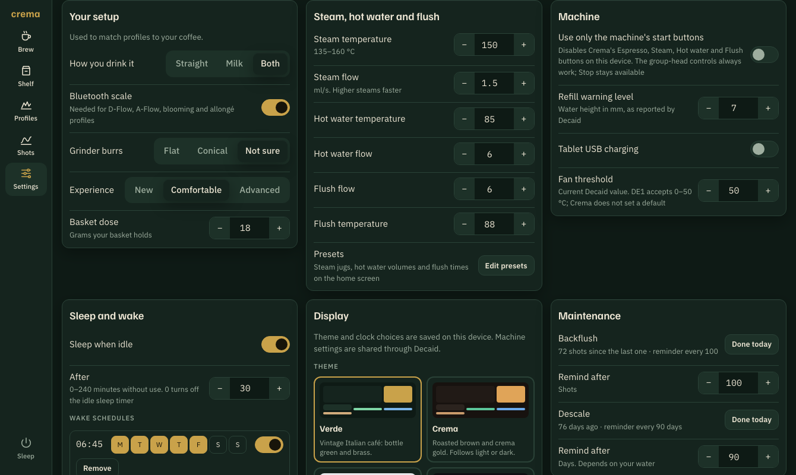 **Settings.** Your setup, steam and water, wake schedules, display and maintenance. |

<p>
  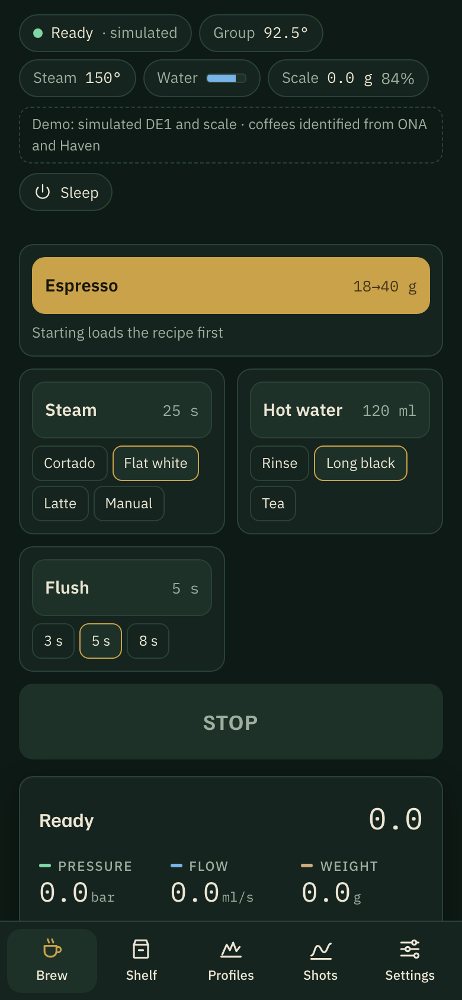
  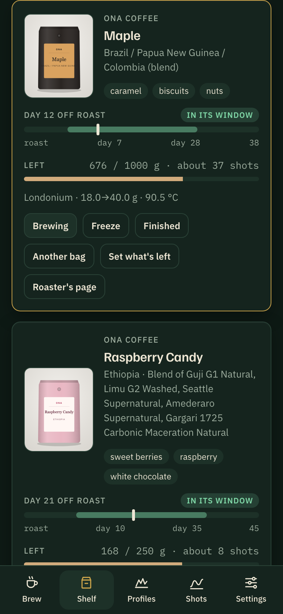
  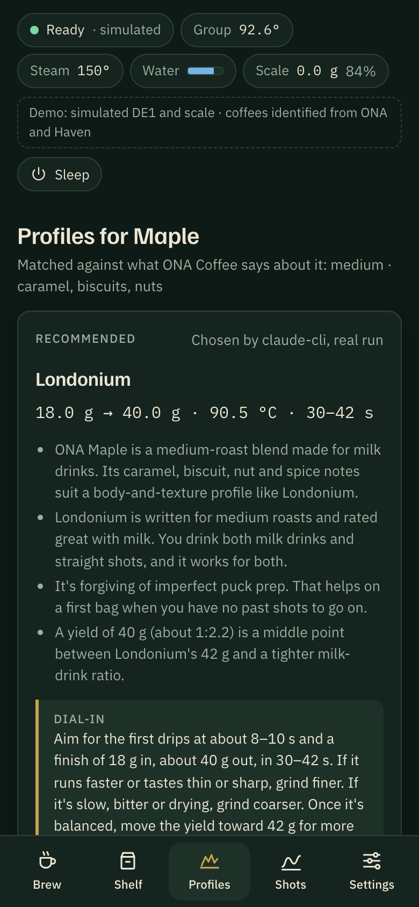
</p>

**On a phone:** the same app, laid out for a narrow screen.

Regenerate these with `node scripts/screenshots.cjs` (needs Playwright). `node scripts/check-tablet-fit.cjs` checks that the home screen fits the tablet without scrolling: at 1340 × 800 and the scaled sizes Android may use, with and without the navigation bar, before and after a shot.

## Themes

Six themes, chosen in Settings → Display and remembered per device. Verde is the default. The layout stays flat and the chart colours stay readable in every one.

| | | |
|---|---|---|
| 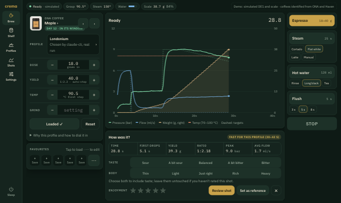 **Verde (default).** Vintage Italian café: bottle green and brass. | 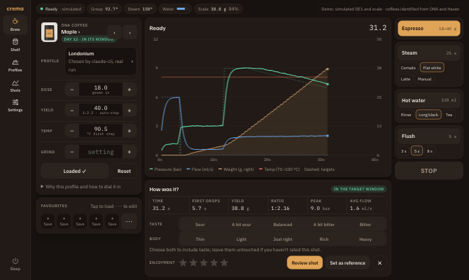 **Crema.** Roasted brown and crema gold. Follows light or dark. | 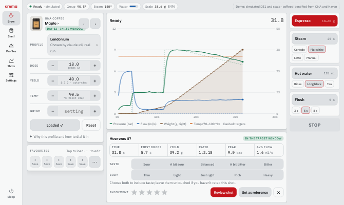 **Rosso.** Italian bar-machine red lacquer on polished steel. |
| 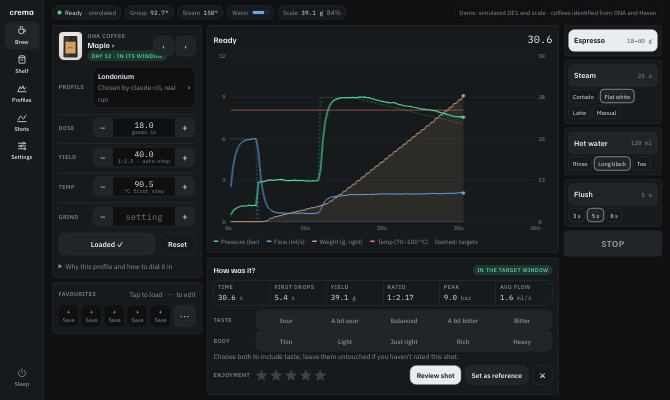 **Acciaio.** Industrial black and steel, like the DE1 itself. | 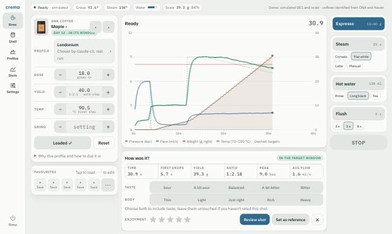 **Nordic.** A light-roast café: birch, ink and fjord blue. | 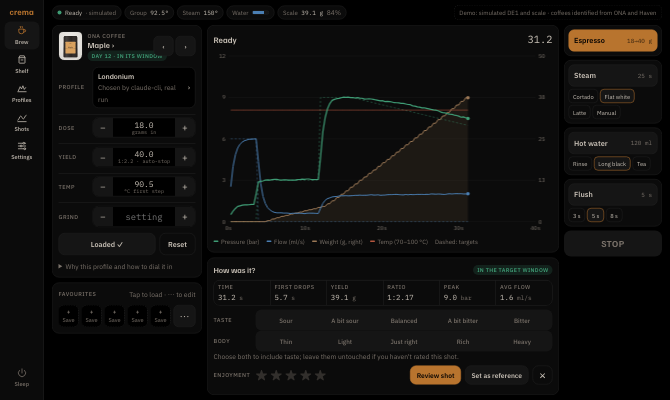 **Notte.** True black and dim amber for the first shot of the day. |

## The demo site

The [demo site](https://gauravawadhwal.github.io/crema/) is built from this repo and deployed to GitHub Pages by `.github/workflows/pages.yml` on every push to `main`. In a fork, enable Pages (Settings → Pages → Source: GitHub Actions) to get your own copy:
- `/` is the walkthrough (`demo/walkthrough.html`).
- `/app/` is the full app (`skin/`). With no machine to talk to, it runs its built-in demo with a simulated DE1 and scale. On a desktop it opens inside a frame at the tablet's exact screen size (1340 × 800, scaled to fit), with a toggle for the phone layout and a link to open it full window. On a phone it fills the screen as usual.

To build it locally, run `node scripts/build-site.mjs`; the site goes in `_site/`. The README animation and the MP4 are recorded from the walkthrough.

## Features

- **A full home screen for the machine.** It has Espresso, Steam, Hot water, Flush and Stop with presets, live pressure, flow, weight and temperature with profile targets, a reference-shot overlay, five favourites, the water tank, the scale, sleep and wake, and "ready in N minutes". It fits a 1340 × 800 tablet in one screen. See [docs/parity.md](docs/parity.md) for the full comparison with the Decent app.
- **Add a coffee** by photographing the bag, searching, or pasting the roaster's link (with the AI server). Crema reads the bag (including the roast date), finds the roaster's page and product photo, and tags every fact with where it came from. Without AI, type in the details from the bag.
- **Profile recommendations from the coffee's description.** It ranks 31 community profiles (Adaptive, D-Flow, A-Flow, Londonium, Extractamundo Dos, allongés, turbo shots and more, described from their authors' own notes) against what the roaster and bag say. It also takes your setup into account (milk or straight, scale, burrs, experience). With AI on, the AI then picks one of the top matches and explains why in plain words.
- **Dial in**: rate a shot (sour ↔ bitter, thin ↔ heavy, stars) and get the one change to make next. Shots outside the profile's time window are flagged.
- **Shelf**: rest window, grams left (from shot doses), reorder nudges, freeze and finish.
- **Shots**: history with metrics, side-by-side comparison, ratings and notes.
- **Settings**: your setup, steam, water and flush, machine, wake schedules, display, and descale and backflush reminders.
- **Six themes**: Verde (the default), Crema, Rosso, Acciaio, Nordic and Notte (see below).

Research and design decisions: [docs/investigation.md](docs/investigation.md).

## How it fits together

```
 DE1 tablet (Crema skin in Decaid) ──┐
                                     ├──► Decaid :8080 on the tablet ──BLE──► DE1 + scale
 Phone (home-screen web app) ────────┘        machine control, beans, profiles, shots,
          │                                   and Crema's own data (key-value store)
          │  optional, for AI
          └──► Crema server :8787 ──► AI provider chain: claude-cli → codex-cli → anthropic-api → gemini-api
```

- **Decaid** is the open-source app on the DE1 tablet (formerly REA / Streamline Bridge). It owns the machine connection and stores beans, profiles, shots and Crema's records and settings.
- **Web app** (`skin/`): the tablet skin, the phone companion and a self-contained demo, all in one. Profile ranking, recipes and dial-in rules run in the browser (`skin/engine.js`, built from `server/`).
- **Crema server** (`server/`, Node + TypeScript) is optional and stateless. It runs on any always-on computer on your network, such as a NAS, a home server or a Raspberry Pi. That's where the Claude or Codex CLI is logged in.

## Try it without a machine

Open `skin/index.html?demo` straight from disk, or the [hosted demo](https://gauravawadhwal.github.io/crema/app/), for a fully in-browser demo with a simulated DE1.

To run the real app against the simulator instead:

```bash
npm install
```

```bash
npm run mock:decaid
```

```bash
DECAID_URL=http://localhost:8080 LLM_PROVIDERS=mock npm start
```

Then open http://localhost:8787 in a browser. Leave out the server, and open `skin/` from any static file server, to see it without AI. Pull a simulated shot with:

```bash
curl -X PUT localhost:8080/api/v1/machine/state/espresso
```

The demo's coffees are nine publicly listed ONA and Haven coffees identified by the real pipeline (`samples/beans.json`), and its recommendations come from real AI runs (`samples/recipes.json`). Rebuild them (this makes AI calls) with:

```bash
LLM_PROVIDERS=claude-cli npx tsx scripts/seed-samples.ts
```

```bash
LLM_PROVIDERS=claude-cli npx tsx scripts/seed-recipes.ts
```

```bash
npx tsx scripts/build-demo-data.ts && node scripts/build-demo.mjs
```

## AI providers

The server tries the providers in order and falls through to the next if one fails or hits a usage limit:

```bash
LLM_PROVIDERS=claude-cli,codex-cli npm start
```

| Provider | Setup on the host | Billed to |
|---|---|---|
| `claude-cli` | `npm i -g @anthropic-ai/claude-code`, then `claude setup-token` and export `CLAUDE_CODE_OAUTH_TOKEN` | Claude Pro/Max |
| `codex-cli` | `npm i -g @openai/codex`, then `codex login` (in Docker, `codex login --device-auth` inside the container: see [install](docs/install.md#logging-codex-in)) | ChatGPT Plus/Pro |
| `anthropic-api` | `ANTHROPIC_API_KEY` | per token |
| `gemini-api` | `GEMINI_API_KEY` (optional `GEMINI_MODEL`) | per token / free tier |

A `GEMINI_API_KEY` also lets you speak into "Describe it": Gemini transcribes the voice note, whichever provider then identifies the coffee.

Subscription CLIs suit a personal installation; use API keys for anything shared.

## Configuration

The tablet and phones are configured in the app (Settings → Connections and AI features). The server is configured with environment variables, listed in [docs/install.md](docs/install.md#configuration). Nothing deployment-specific lives in the repo.

## Server API

The server is stateless: it answers questions and stores nothing but cached product photos.

| Method | Path | Does |
|---|---|---|
| `GET` | `/api/config` | provider chain, `voice` (the provider that transcribes, or null), and the Decaid address when `DECAID_URL` is set |
| `POST` | `/api/identify` | multipart `images[]`, `query`, `description` (with `today`, YYYY-MM-DD), `url`, `offline` → coffee record |
| `POST` | `/api/transcribe` | multipart `audio` (WAV, up to 4 MB) → `{text, provider}`. Needs `GEMINI_API_KEY`; 501 without one |
| `POST` | `/api/recommend` | `{bean, profileTitles?, history?, preferences?}` → recipe chosen by the AI among the installed profiles |
| `POST` | `/api/dialin` | `{bean, recipe, shot, feedback, history?}` → `{advice, source}` |
| `POST` | `/api/review` | Recorded profile/curves, optional taste and earlier shots → `{review, source}`; saved by the client in Decaid |
| `POST` | `/api/images/cache` | `{url}` → a cached copy of a roaster's product photo |
| `GET` | `/api/images/:file` | cached product photos |
| any | `/decaid/*` | proxy to Decaid's REST API when `DECAID_URL` is set, for the app opened from the server |

## Development

```bash
npm test
```

```bash
npm run typecheck
```

```bash
npm run e2e
```

```bash
npm run e2e:live
```

```bash
npm run check:tablet
```

- `npm test` covers the server (identify → recommend → dial-in with the mock LLM, and the proxy) and checks `skin/engine.js` is up to date with `server/`. Rebuild it with `npm run build:engine`.
- `npm run eval` measures the AI itself: 90 labelled cases for coffee identification, profile recommendation and dial-in advice, run through the real pipeline with any provider and model, with cost, latency and regression checks against committed baselines. See [evals/README.md](evals/README.md).
- `npm run e2e` clicks through the demo at tablet and phone size. `npm run e2e:live` runs the app against the simulator with no server, with the server, with the server stopped, with AI switched off, and from a phone through the server. `npm run check:tablet` fails if the home screen doesn't fit a 1340 × 800 tablet without scrolling. Playwright is a dev dependency; run `npx playwright install chromium` once to download its browser. CI runs all of these on every pull request.

**For contributors and coding agents:** start with [CLAUDE.md](CLAUDE.md), which covers the layout, commands, conventions and known pitfalls. Then read [docs/architecture.md](docs/architecture.md) and [docs/design.md](docs/design.md). Repeatable workflows are in `.claude/skills/`.

## Roadmap

- [ ] Test on a real DE1 and tablet, including installing the skin from a release
- [ ] Tune the prompts with real bag photos (every provider has run against real accounts in the evals; the label photos there are rendered, not real)
- [ ] Home Assistant: expose machine state, shot count and the current coffee as sensors, and add warm-up and sleep automations
- [ ] Add coffees from roaster order emails, so only the roast-date sticker needs photographing
- [ ] Grinder entities and a numeric grind advisor
- [ ] Profile editing and Visualizer profile import
- [ ] Optional native phone extras: widgets and a live shot activity

## Acknowledgements

- [Decent Espresso](https://decentespresso.com) for the DE1 and its open ecosystem, and the [Decaid](https://github.com/decentespresso/decaid) project (GPL-3.0), which Crema talks to over its API. Crema contains no Decaid code.
- The community profile authors whose notes the profile catalog is described from: Damian Brakel, Janek, Scott Rao, Jonathan Gagné, Joe D., John Weiss, longpvo, Denis (KafaTek), Luca & Stéphane, Shin and the Decent team.
- The Streamline and Lumen skins, for the feature set a day-to-day interface needs.
- ONA Coffee and Haven Coffee, whose public product listings make up the demo's sample coffees.

Crema is an independent project, not affiliated with or endorsed by Decent Espresso or any roaster. Product and company names belong to their owners.

## License

[MIT](LICENSE)
